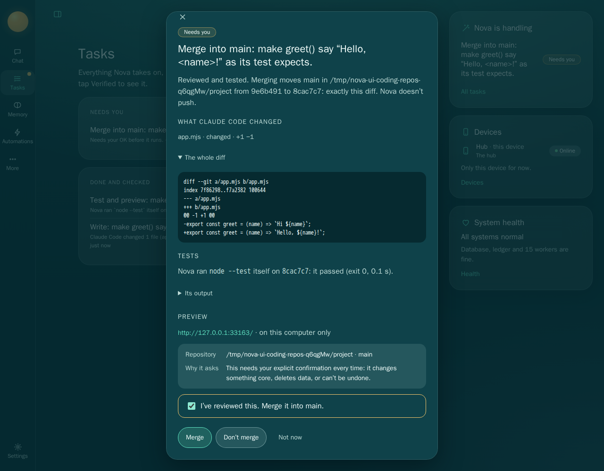
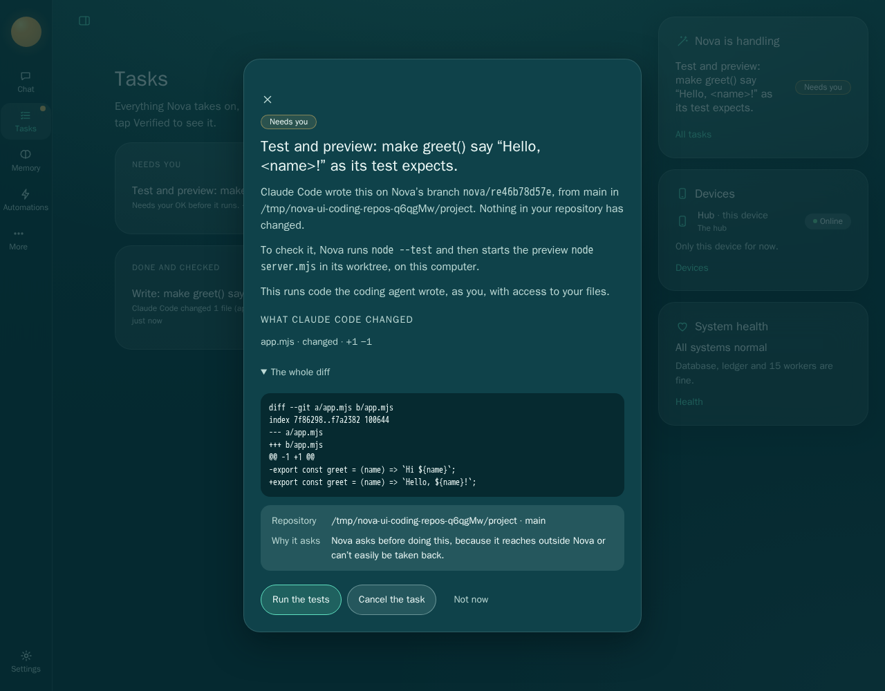

# M10c gate evidence: coding through chat

The ADR is `docs/plans/M10.md` (its M10c section and Hard limits), and the plan is
`docs/plans/M10c.md`. Everything here ran on 2026-10-31 on this machine (WSL2, Node 26.3.1, git
2.53.0), against throwaway repositories made in the system's temp folder: a small project as the
person's repository and a bare clone of it beside it as its "remote". No test operates on this
repository or any other checkout, nothing pushes, and the coding agents are the stand-ins in
`scripts/stand-ins/` (scripted edits, never a model). Previews bind 127.0.0.1 on a free port and stop
with their run or their test.

## Suite

`npm run check` passes: the token lint, themes, typecheck, and **1067 tests: 1058 pass, 0 fail, 9 skipped**. The 9 skips are the
existing opt-in real-service tests (real Ollama, real Claude, real Relay); none of the new tests skip
on Linux. Before M10c the suite was 1046 tests (1037 pass, 9 skipped).

`scripts/ui-test.sh` (Chromium in the Playwright container): **87 tests: 87 pass, 0 fail** (the whole UI gate, with the new M10c test).

The new tests:

| File | Tests | What it proves |
|---|---|---|
| `tests/core/coding.test.ts` | 12 | The gate through the ledger: reviewed diff, green tests, running preview, then the tier-3 ask; decline; approve; the branch moved; a failing test; refusals; a preview open to the network; a dirty checkout; undo; Codex and Relay as the agent; what starting checks; two runs at once; a restart |
| `tests/core/coding-git.test.ts` | 5 | Nova's git: local paths only, no `GIT_*` of its own process, branch names, the loopback reader, and a whole run (merge included) with every hook and an fsmonitor planted in the person's repository: none ran |
| `tests/acceptance/m10c-coding.test.ts` | 1 | The gate end to end through chat, for a fresh user, on the real server with the egress tripwire |
| `tests/ingest/coding-guard.test.js` | 2 | `code_change` is a guarded step: after a web read it asks first, naming the source; untainted it starts on its own |
| `tests/ui-components.test.js` | +1 | The check and merge sheets' content and rules |
| `tests/ui/m10c-coding.test.ts` | 1 | The sheets in Chromium: diff, tests and the live preview link before Confirm; Merge disabled until the box; Don't merge; Merge |

`tests/acceptance/fresh-user.test.ts` passes unchanged.

**Seen failing.** Each guard below was removed in turn and its test run against that:

| Guard removed | What failed |
|---|---|
| `core.hooksPath=/dev/null` in Nova's git | The hooks test: `post-merge` and `reference-transaction` in the person's repository ran during the merge |
| The "branch moved" check before the merge | The moved test, at the message (git's own fast-forward refusal still kept the branch, so the check is the first of two walls) |
| The early stop on a failed test run | The failing-test test (the verifier still refused the evidence and held the task, so no merge ask appeared either way) |
| The preview's loopback check | The every-address test: the check passed with the preview on `0.0.0.0` |
| The rule that the agent doesn't change the tests | The refusals test, at the agent that edited `app.test.mjs` |
| `protocol.allow=never` in Nova's git | The local-paths test, at `https://example.invalid/repo.git` (`.invalid` is reserved; nothing can answer) |

**Not proven by its test:** "two runs on one repository at once" passed with the per-repository lock
removed, three times out of three. The lock is kept (two fetches into one bare repository can race for
a ref's lock), but that test doesn't show the race.

## Gate items

### 1. A coding request in chat ends as a reviewed diff with green tests and a running preview

`tests/acceptance/m10c-coding.test.ts` (the real server; a blank profile set up by conversation; a
scripted chat model, `scripts/stand-ins/fake-coder-chat.js`, that calls `code_change`; Claude Code's
stand-in as the agent). Its transcript (`NOVA_EVIDENCE`), with the temp folder shown as `<tmp>`:

- Local-only: the request in chat was refused, and chat said why: “No coding agent is on. What is on sends data off your devices, and your privacy setting is local-only. Turn on a local model to use here.” No run was made.
- Chat: “In the repository at <tmp>/project, make greet() say “Hello, <name>!” as its test expects. Test with `node --test`, preview with `node server.mjs`.” → the chat model called code_change → coding run r01a95f23bf.
- Write (tier 1): Claude Code changed 1 file (app.mjs). Nova committed it as 1f3d907 on nova/r01a95f23bf in its own copy of the repository; main in <tmp>/project is untouched. greet() now says Hello, with the name and an exclamation mark.
  - Verified: Nova read its own repository: nova/r01a95f23bf is at 1f3d907, on 784c928, changing 1 file, as recorded.
- Check (tier 2) asked first: “Needs your OK before it runs.” — the person sees the diff:

```diff
diff --git a/app.mjs b/app.mjs
index 7f86298..f7a2382 100644
--- a/app.mjs
+++ b/app.mjs
@@ -1 +1 @@
-export const greet = (name) => `Hi ${name}`;
+export const greet = (name) => `Hello, ${name}!`;
```

- Check ran: Nova ran `node --test` itself on 1f3d907: it passed (0.1 s). The preview is up at http://127.0.0.1:43353/, on this computer only.
  - test_result: Nova ran `node --test` itself in its worktree at 1f3d907: it passed (exit 0, 0.1 s).
  - confirmation: Nova started the preview itself at http://127.0.0.1:43353/ (it answered HTTP 200, and listens on this computer only).
- Merge (tier 3) asks: “Move main in <tmp>/project from 784c928 to 1f3d907: exactly the reviewed change for “make greet() say “Hello, <name>!” as its test expects.”. Nova doesn’t push.”. Test node --test passed on 1f3d907; the preview at http://127.0.0.1:43353/ answered “Hello, preview!”.
- Declined: You declined the merge. main is as it was; nothing was merged or pushed. main is still 784c928; the person’s repository (with .git) and the bare remote hash the same as before; the preview stopped.
- Confirmed (second run rd0510fc94d): main in <tmp>/project moved from 784c928 to e9e366f: exactly the reviewed change. Nothing was pushed.
  - Verified: Nova read main in <tmp>/project itself: it is at e9e366f, the reviewed commit.
  - `git diff <base> main` in the person’s repository is byte-identical to the reviewed diff; the bare remote is unchanged.
- Egress tripwire: nothing tried to leave this machine.

### 2. It asks before merge

The merge task exists only once the check is verified done, and it is tier 3: approving it without
`confirm: true` answers 400 ("explicit confirmation"), in the acceptance test and in
`coding.test.ts` ("M10c gate: …"). The person is told when it is ready (a proactive message: "The
change … is ready for you to review: `node --test` passed, and its preview is at
http://127.0.0.1:…/ (on this computer)…"). In the UI (`tests/ui/m10c-coding.test.ts`), the merge sheet
shows the reviewed diff open, Nova's test result and the preview link, and Merge stays disabled until
the box is ticked:



The check before it (tier 2) shows the change and says what running it means:



### 3. Declining leaves nothing merged: the target branch byte-identical, no push

`coding.test.ts` "M10c gate: …", the acceptance test, and the UI test: after "Don't merge", the
person's repository (every file, `.git` included, by path, mode and bytes: `treeHash` in
`tests/support/coding.ts`) and the bare remote hash exactly as before the request; `main` is the same
commit; the preview no longer answers; the merge task is `cancelled` and the run `declined`. Nothing is
written to the person's repository before a confirmed merge, not even objects: Nova only fetches from
it into its own bare repository.

### 4. Approving merges exactly the reviewed diff; a moved branch asks again

- `coding.test.ts` "approving merges exactly the reviewed diff…": after the confirmed merge, `main` is
  the reviewed commit, `git diff <base> main` in the person's repository is byte-identical to the diff
  the person reviewed, the checkout moved with the branch and is clean, and the bare remote is
  unchanged (`rev-parse main` there is still the base): nothing pushed. The acceptance test checks the
  same through the API.
- `coding.test.ts` "the branch moved after review…": a commit lands on `main` after the review; the
  confirmed merge fails with "main moved since you reviewed the change (it is at … now; the review was
  against …). Nova merged nothing, and brings the change up to date to ask you again"; `main` and the
  repository are untouched. Round 2 runs by itself: update (Nova merges the new tip into its branch),
  check (asks again: "Needs your OK"), merge (a new tier-3 ask, `approved_at` null). Confirmed, `main`
  holds both the person's commit and the change.
- `coding.test.ts` "the person's checkout with uncommitted changes is never merged over": the merge
  waits ("… has changes that aren't committed. Nova doesn't merge over them"), nothing written; once put
  away, a retry asks again before merging.

### 5. A failing test run never reaches the merge ask

`coding.test.ts` "a failing test run never reaches the merge ask": an agent whose change fails the
test; the check fails with "Nova ran `node --test` itself on <commit>: it failed (exit 1)… Nova won't
ask you to merge it"; no merge task was ever made; the run is `failed`, with no preview; the person's
repository is untouched. A preview that listens on every address fails the check the same way ("The
preview listened on every address (0.0.0.0), not only on this computer, so Nova stopped it").

### 6. The fresh-user test

`tests/acceptance/fresh-user.test.ts` passes unchanged, and the M10c acceptance test itself starts from
a blank profile set up by conversation, with no names or services but placeholders.

## Tiers, as built

| Step | Tier | Evidence Nova checks |
|---|---|---|
| Write (Nova's worktree; undo: discard) | 1 | `confirmation` `nova-coding` `commit:`: Nova reads its own repository |
| Update (a new round) | 1 | the same |
| Check (tests, then the preview) | 2 | `test_result` `nova-coding-run:` (Nova's record of its own run, at that commit); `confirmation` `preview:` (Nova's record, the process alive) |
| Merge | 3, every time | `confirmation` `merge:`: Nova reads the person's branch back |
| Starting from chat after reading outside content | asks (guarded step) | — |

## Reused and new

See `docs/plans/M10c.md` ("Built on what exists") and the CAPABILITY-INVENTORY row "Coding through
chat". In short: the Work Ledger, the provider registry and its four coding adapters (through
`Providers.workIn`, which shares the registry's own gates with its `#run`), `taskspace.ts`, `checks.ts`,
`cli.ts`, `children.ts`, `computer/policy.ts`, the trigger engine, the ingest gate's guarded steps and
outbound guard, and the approval sheet are reused. New: `src/core/coding/`, migration 0017, two chat
tools, the coding sheets.

## Known limits

- Tests and the preview run on this computer, as the person, after their OK (tier 2); not in an M10a
  workspace, where a preview couldn't be reached.
- The test command may reach the network; Nova doesn't stop it there (the person sees the command
  first).
- The preview link works on this computer only.
- No deploy and no push; a merge can't be undone by Nova.
- Only fast-forwards to the reviewed commit; a moved branch is reviewed again on a merge commit.
- A preview doesn't survive a restart (tested: the merge ask says it stopped, and still merges only the
  reviewed commit).
- The loopback check is Linux only (`/proc/net`); elsewhere the run says it wasn't checked.
- A checkout of the person's branch runs the clean/smudge filters their own config defines (Git LFS).
- Submodules aren't supported: an uninitialised one is an empty folder in Nova's worktree, and the
  agent can't change it.
- No real coding agent was run for this gate: the stand-ins speak each CLI's real protocol (as in M5
  and M8). A run on the owner's subscription needs their OK.
