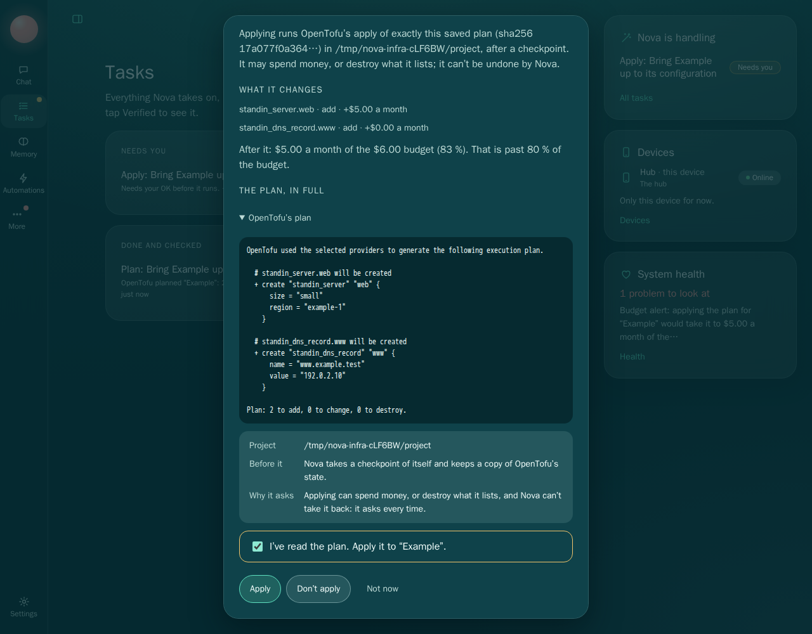
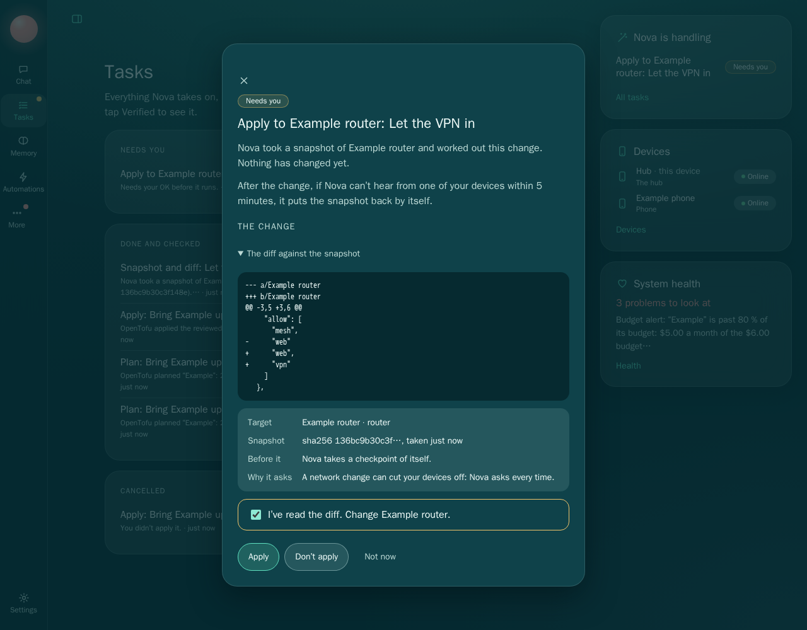

# M10d gate evidence: infrastructure, networking and accounts through chat

The ADR is `docs/plans/M10.md` (its M10d section and Hard limits), and the plan is
`docs/plans/M10d.md`. Everything here ran on 2026-10-31 on this machine (WSL2, Node 26.3.1), against
stand-ins only, in folders made under the system's temp folder:

- **OpenTofu** is `scripts/stand-ins/fake-tofu.js`, put on a PATH of the test's own as `tofu`. Its
  "infrastructure" is a state file in the project's temp folder, and its "provider" is leaky on
  purpose: it prints its token on every plan and apply. No OpenTofu, Terraform or provider is
  installed or run.
- **The network target** is `scripts/stand-ins/fake-netconfig.js`, a loopback server whose
  configuration is a JSON file in a temp folder. No interface, firewall, route, DNS, hosts file,
  router or Tailscale setting of this machine or the owner's is read or changed; no test runs
  `tailscale`, `iptables`, `nft`, `ip` or `resolvectl`.
- **The account site** is `scripts/stand-ins/account-site.js` on loopback. No account is created, no
  password or MFA is changed anywhere real, and nothing is paid.
- **The phone** is a device enrolled the way the plan says (join, reveal, approval at the console,
  a signed session) over the real mesh listener, on loopback.
- Tokens and passwords are made per test with `randomBytes`. The running preview (ports 4318 and 4320,
  `~/Nova-preview`) and every other checkout were not touched.

## Suite

`npm run check` passes: the token lint, themes, typecheck, and **1094 tests: 1085 pass, 0 fail, 9
skipped**. The 9 skips are the existing opt-in real-service tests (real Ollama, real Claude, real
Relay). Before M10d the suite was 1067 tests (1058 pass, 9 skipped). One earlier full run had one
failure in an untouched test, the Screenpipe cursor test in `tests/core/capture.test.ts` (a pull
answered without `kept` under the full suite's load); it passed three times alone and in the next full
run. It is written down here as a flake, not fixed.

`scripts/ui-test.sh` (Chromium in the Playwright container): **89 tests: 89 pass, 0 fail** (the whole
UI gate, with the two new M10d tests; the two were run again, and passed, after the last change to
`src/core/network/`).

The new tests:

| File | Tests | What it proves |
|---|---|---|
| `tests/core/infra.test.ts` | 9 | The gate through the ledger: the plan in full before a tier-3 apply that needs the confirmation; the checkpoint before the apply (its database has none of the apply's records); Nova reads the state back; decline; over budget and unpriced plans never offered, with alerts; 80 %; the apply's own budget re-check; a plan changed after review; destroy at tier 3; a missing secret; the leaky provider's token nowhere; the budget arithmetic |
| `tests/core/network.test.ts` | 9 | The gate on the real core, its mesh listener and an enrolled phone: snapshot, diff, tier-3 apply, contact lost and reverted by itself; contact kept; the hub's own screen isn't contact; a device paired after the change isn't either; no device, no change; a secret in a patch refused and masked; a target changed since the snapshot left alone; a revert that would overwrite someone else's change stops; after a restart, a change past its deadline reverts; Nova stopped mid-write still has its switch |
| `tests/core/accounts.test.ts` | 3 | Account steps are tier 3; a plan never holds a password; a password or code field is never filled from a plan; MFA needs a code step; the password Nova makes; a confirmation left waiting stops before any browser and asks again; the pending password |
| `tests/ingest/ops-guard.test.js` | 4 | `infra_plan`, `network_change`, `account_change` are guarded steps: after a web read each asks, naming the source, and a no starts nothing; untainted, an account step starts and asks in Tasks |
| `tests/acceptance/m10d-ops.test.ts` | 1 | The gate end to end through chat, on a blank, local-only profile, on the real server with the egress tripwire |
| `tests/ui-components.test.js` | +1 | The apply and network sheets' content and rules |
| `tests/tools.test.js` | (changed) | The tool protocol lists the five new tools |
| `tests/ui/m10d-account.test.ts` | 1 | In Chromium: a password change, an account creation, and two-step sign-in with the person typing the code through takeover; no password anywhere Nova writes |
| `tests/ui/m10d-sheets.test.ts` | 1 | In Chromium: the apply sheet (the plan in full, priced, against the budget) and the network sheet (the diff and the switch); Apply disabled until the box; Don't apply; Apply |

`tests/acceptance/fresh-user.test.ts` passes unchanged.

**Seen failing.** Each guard below was removed in turn (a script restored the file after each) and
its test run against the code without it:

| Guard removed | Test that failed |
|---|---|
| Infra apply at tier 3 (`TIER.apply`) | infra gate: the apply ran without asking |
| Over-budget plans never offered | the budget-breach test |
| Unpriced plans never offered | the unpriced test |
| The apply's own budget re-check | the 80 % / re-check test: the apply ran under the lowered budget |
| The reviewed plan's sha256 checked at apply | the changed-after-review test |
| The checkpoint before the apply | infra gate: no new checkpoint |
| Redacting what the tool says | infra gate: the leaky provider's token in the run's record |
| Network apply at tier 3 (both the worker's floor and the ask) | network gate |
| The switch's revert | network gate: never reverted |
| `Devices` emitting `heard` (the contact signal) | the kept test: reverted though the phone kept reaching the hub |
| Only devices trusted at the apply count | the paired-afterwards test (written after this guard first went uncaught; see below) |
| The compare-and-swap on the snapshot's version | the changed-since-snapshot test: their change was overwritten |
| A revert never overwrites someone else's change | the revert test |
| No device, no change | the no-device test |
| A patch that sets a secret refused | the same test |
| The snapshot sealed on disk | network gate: the Wi-Fi key in a file in Nova's home |
| The sweep at start and on the heartbeat | the restart test (with both removed; either alone still fires it) |
| The switch's deadline written before the write | the mid-write test (it never reverts; the run times out) |
| Account plans at tier 3 | the accounts validator test |
| The presence check (10 minutes) | the accounts gate test: it went on to look for a browser |
| No password or code field filled from a plan | the accounts validator test |
| No value in an account step | the accounts validator test |

**Not caught at first, written down:**
- Network tier 3: removing only the worker's `minTier` changed nothing, because the module asks for
  tier 3 on the task itself too; the test fails only with both removed. Two walls, as built.
- "Only devices trusted at the apply count": no test covered it. A test was added (a device paired
  after the change, making requests all through the window: the change still reverts), and it fails
  with the guard removed.
- The restart sweep: removing the sweep in `recover()` alone didn't fail, since the heartbeat's
  first beat at start sweeps too. Removing both fails.

**Found by a test, fixed:** the acceptance test's search of every file found the router's Wi-Fi key
in clear in `workers/network/<change>/snapshot.json` and `proposed.json`. The snapshot must keep the
real values (the revert writes them back), so it is now sealed (AES-256-GCM) with a key of the
change's own, kept in the vault and dropped with the files.

## Gate items

### 1. A plan is shown before apply, and apply asks

`tests/acceptance/m10d-ops.test.ts` (the real server; a blank profile set up by conversation,
local-only; the scripted chat model `scripts/stand-ins/fake-ops-chat.js` calls `infra_plan`). Its
transcript (`NOVA_EVIDENCE`):

- Chat: “Plan the infrastructure project Example.” → infra_plan → run i39a3ae1c60.
- Plan (tier 1, automatic): OpenTofu planned “Example”: 2 to add. +$5.00 a month: $5.00 a month of the $20.00 budget (25 %). Nothing was changed.
  - The plan, shown in full before any apply:

```
OpenTofu used the selected providers to generate the following execution plan.

  # standin_server.web will be created
  + create "standin_server" "web" {
      size = "small"
      region = "example-1"
    }

  # standin_dns_record.www will be created
  + create "standin_dns_record" "www" {
      name = "www.example.test"
      value = "192.0.2.10"
    }

Plan: 2 to add, 0 to change, 0 to destroy.
```

- Apply (tier 3) asked; without confirm: “This is a tier-3 task: approving it needs an explicit confirmation.”. Confirmed: OpenTofu applied the reviewed plan for “Example”: 2 to add. A checkpoint was taken first (000001-before-applying-the-infrastructure-plan).
  - Verified: Nova read OpenTofu’s state itself: 2 planned changes, each as planned (2 resources in the state now).

In `tests/core/infra.test.ts` (gate): the state file doesn't exist before the confirmation, and the
stand-in's own log shows no `apply`; the checkpoint's `nova.db` holds none of the apply's
`infra_resource` rows (it was taken before); declining cancels the apply task and nothing is ever
applied. In Chromium (`tests/ui/m10d-sheets.test.ts`), the sheet shows the plan open in full, each
change with its price, and Apply disabled until the box is ticked:



### 2. A budget breach alerts and blocks

- Budget breach: “The plan for “Big” would cost +$40.00 a month, taking it to $40.00 a month of the $10.00 budget (400 %): over budget. Nova applied nothing and won’t offer it. Lower the plan, or raise the budget yourself.” No apply task exists; the problem is listed and the person was told.

`tests/core/infra.test.ts` also: a plan with a resource type the price sheet lacks is never offered
(“Budget guardrail: Nova can’t price standin_bucket.files …”); the apply checks the budget again as it
runs (the person lowered it after the review: refused, with an alert); a project past 80 % once applied
raises one problem, not one per heartbeat, and going over raises another. Every resource Nova
provisions is recorded with its monthly price under its project's budget.

### 3. A network change applies, the stand-in loses contact, and the change reverts by itself

`tests/core/network.test.ts`, the gate test: the real core behind its console and mesh listeners, a
phone enrolled the way the plan says, and the simulated network: the phone reaches the hub's mesh
listener only while the stand-in's firewall allows `mesh`. The change “Close everything but the web”
drops it:
1. Prepare (tier 1): “Nova read its snapshot itself: sha256 …, as recorded.” Nothing was written to the
   target (no PUT).
2. The diff, with the Wi-Fi key in no view.
3. The apply asks at tier 3 (refused without the confirmation); confirmed, a checkpoint is taken and
   the target holds the change: “Nova read the target back itself after the change: … the reviewed
   configuration exactly.”
4. The phone's requests are dropped. With no contact inside the window, Nova makes the revert itself
   (tier 1, `by: switch`), and: “Nova read the target back itself after the revert: … the snapshot
   exactly.” The target's file is byte for byte what it was. The problem says “Nova lost contact with
   your devices after “Close everything but the web” on Example router, so it is putting the snapshot
   back by itself.” The phone reaches the hub again.

And a change the phone still reaches through is **kept** (“Kept: Nova heard from Example phone after
the change, so your devices still reach it.”), with no revert after the window; the person can still
put it back, at tier 3. Requests to the hub's own screen (the console listener) all through the window
don't keep a change; nor does a device paired after it. The acceptance test does the kept path through
chat, with the phone paired over the real server's mesh listener:

- Network change with no paired device: refused, and chat said why (“Pair your phone first”).
- Network change (tier 3) applied after the confirmation. The diff the person saw:

```diff
--- a/Example router
+++ b/Example router
@@ -9,5 +9,6 @@
   "dns": {
     "records": {
-      "printer.home.example": "192.0.2.20"
+      "printer.home.example": "192.0.2.20",
+      "nas.home.example": "192.0.2.30"
     }
   },
```

- Kept: Nova heard from Example phone after the change, so your devices still reach it.

The window: 5 minutes by default (the owner's open question 2), `mesh.contact_window_s`; tests use a
window of under a second through `createCore`'s options.



### 4. An account step asks with the person present

- Account step: “Change my password at 127.0.0.1:5099.” → account_change → a tier-3 task (“Change the password on 127.0.0.1:5099”), waiting for the person; declined.

`tests/ui/m10d-account.test.ts` runs the steps in Chromium on the stand-in account site:
- a password change: tier 3, refused without the confirmation; the site took a 24-character password
  Nova made; a fresh sign-in from the vault works with it; the step's send was its commit point;
- an account created (`person@example.test`), its sign-in saved;
- two-step sign-in: Nova asked “Type the code the site sent to your phone. Type it yourself: Nova
  doesn’t read or type codes.”; the test, as the person, took over, typed the code the site had
  "sent", and handed back; two-step sign-in is on, and the code is in no record.

`tests/core/accounts.test.ts`: a confirmation left waiting more than 10 minutes stops before any
browser opens (“Nova changes an account only while you’re here, within 10 minutes of your OK …”), sends
nothing, and retrying asks again.

### 5. No secret appears in any transcript, log or evidence

- Secrets: the project’s provider token (printed by the leaky stand-in on every plan and apply), the router’s token, its Wi-Fi key and the saved sign-in’s password are in no file under the test machine’s folder (Nova’s home, the user folder, the egress log), the server’s output, the 5 chat transcripts, or the API’s tasks, runs, changes, problems and messages.
- Egress tripwire: nothing tried to leave this machine.

In Chromium, the old password, the new one Nova made and the created account's are in no file under
the test machine's folder, the server's output, or the tasks and their events. The leaky provider's
own words are kept as “stand-in provider: authenticated with token [redacted]”.

### 6. The fresh-user test

`tests/acceptance/fresh-user.test.ts` passes unchanged; the M10d acceptance test itself starts from a
blank profile set up by conversation.

## Tiers, as built

| Step | Tier | Why |
|---|---|---|
| Infrastructure plan | 1 | It changes nothing; reading the provider is its only reach |
| Infrastructure apply (and destroy) | 3, every time | It spends or destroys, and Nova can't take it back |
| Network prepare (snapshot, diff) | 1 | Nothing on the target changes |
| Network apply | 3, every time | A network change can cut the person's devices off |
| The switch's revert | 1 | Confirmed with the change; it puts back what was there |
| A revert the person asks for | 3 | A network change of its own |
| Account change, creation, MFA | 3, every time | And within 10 minutes of the confirmation; codes are the person's |
| Settling a pending password | 3 | Which password Nova uses for a site |

## Reused and new

Reused: the Work Ledger (tasks, `minTier`, tier 3's confirmation every time, `internal`, `effects`
and `commits`, recovery); `Checkpoints.auto`; the vault; `log.problem` and the trigger engine's
messages (alerts); `providers/cli.ts` (`runLines`, `which`) and `children.ts`; `unifiedDiff`;
`checkFolder`; the device registry, sessions and the access policy (contact); Nova Browser's plans,
validator, `SECRET`, `Redactor`, takeover and `needsPerson`, send guard and covered screenshot; Era
2's tool protocol, `GUARDED` steps and the outbound check; the approval sheet's rules.

New: `src/core/infra/` (the OpenTofu adapter, prices and budgets, the `infra` worker), `src/core/network/`
(the `http-config` adapter, merge patch and masking, the `network` worker and the switch), migration
0018, `Devices`' `heard` event, three account steps and the presence check in Nova Browser, five chat
tools, two sheets, four stand-ins (`fake-tofu.js`, `fake-netconfig.js`, `account-site.js`,
`fake-ops-chat.js`).

## Known limits

See the plan's "Gaps, written down" and the LEDGER entry of 2026-10-31 (M10d). In short: prices are
the person's sheet, not a bill; the tool runs on this computer; the state copy isn't a rollback;
projects and targets are registered through the API only; one network adapter; contact needs a device
that makes a request inside the window; the pending password is settled through the API only.
