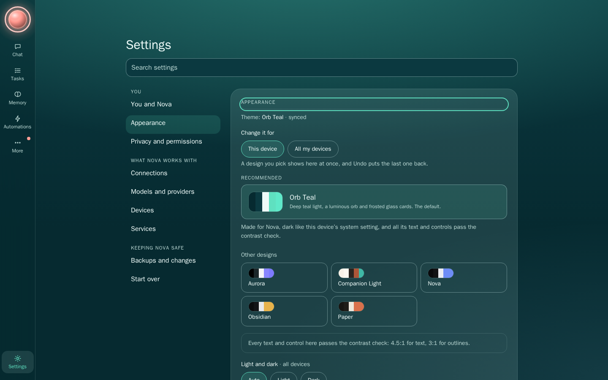
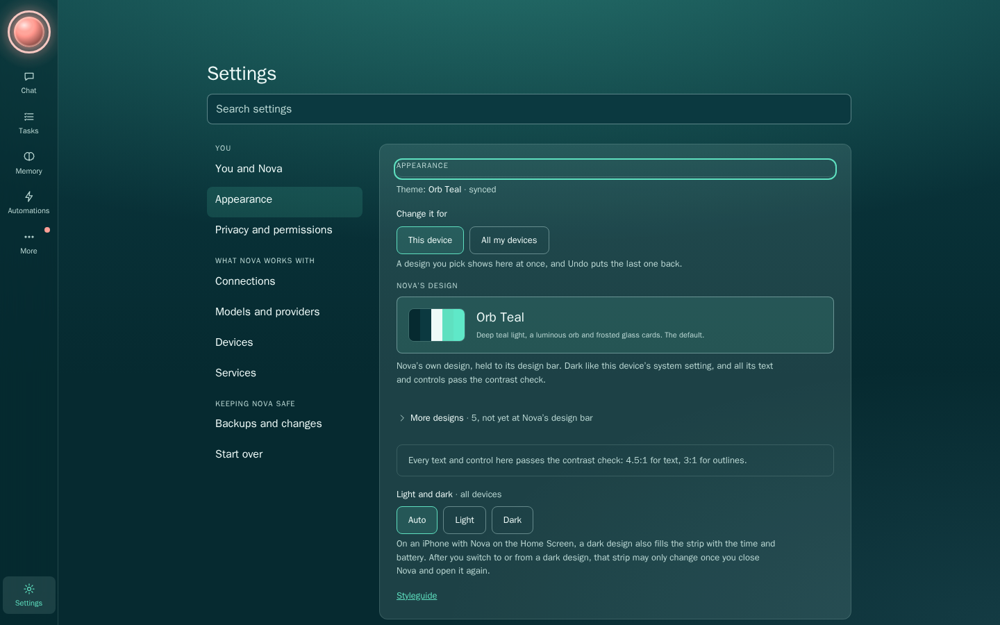
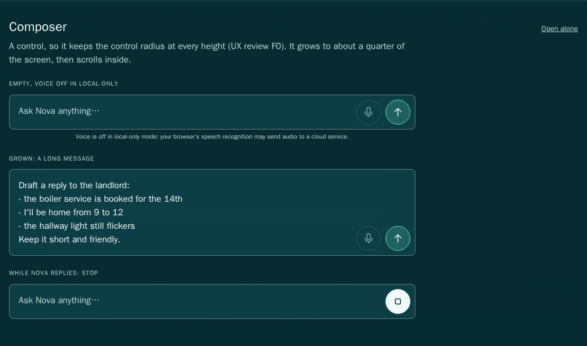
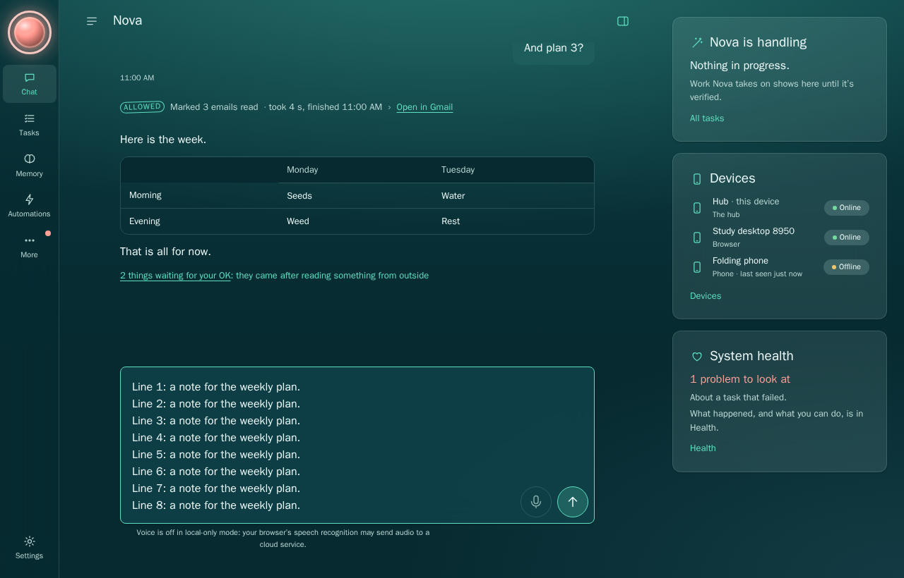

# Design quality stage 1 — rendered review packet

**Owner-approved as stage 1, 2026-11-01:** the machinery (§0, styleguide, token values and slop gate). [Approval and attached notes](../builder-packet/INPUT-2026-11-01-DESIGN-STAGE1-APPROVAL.md). Merge requires green CI on the updated head. Exemplar set: **proposed 2026-11-01, owner may amend**. Stage-2 visual priorities are recorded in the [follow-up queue](../plans/design-quality-stage2-queue.md).

## What to judge

Nova should feel like one deliberately designed product: conversational restraint in Chat; Linear/Raycast crispness in Home, Tasks, Health and Activity; macOS/Raycast clarity in Settings. Orb Teal is the lead. Other packages inherit its structure and re-express values only.

Binding sources: [owner input](../builder-packet/INPUT-2026-11-01-DESIGN-QUALITY.md), [diagnosis](../builder-packet/nova-design-quality-system-2026-11-01.md), [DESIGN-SYSTEM §0 and §2.1](../builder-packet/DESIGN-SYSTEM.md), and [operating rules](../builder-packet/OPERATING-RULES.md). After this stage merges, a new surface starts as an owner-approved rendered styleguide entry before app code. Existing surfaces conform opportunistically.

## Claims and limits

- `/styleguide` uses production render functions, CSS and the token endpoint. Each of its 39 entries has a stable `#sg-…` anchor and an `?entry=…` address for isolated approval. The v1 inventory is covered, with ordinary, empty, waiting, failure, disabled and confirmation examples. Export coverage also includes hub, coding, infrastructure, network and browser-control sheets. This is a catalogue of states, not a simulation of every possible live-data combination.
- The coverage guard requires every exported component to have a rendering, with only named non-component helpers exempted. Gmail now has explicit disconnected, connected, reconnecting and remote-client specimens. The unused exported toast helper is named; the styleguide shows the shell's actual toast markup.
- Orb Teal uses fixed 4pt spacing; six approximately 1.2-ratio type steps; 8px controls and 12px containers; two shadow levels; one ordered motion family; one 24-unit, 1.5-stroke SVG set. Lint catches off-scale spacing/type/radius and growing pills, as well as raw values. Safe-area and measured geometry exceptions are explicit.
- Settings presents Orb Teal first and puts five alternatives behind **More designs**. Its reason admits when the lead is dark despite a light OS. Existing alternatives remain usable. Their scale debt is reported by `check:themes`; they are not portrayed as reviewed peers. The technical `at_bar` flag is not proof of owner approval of this PR.
- Onboarding already used Orb Teal without a six-theme question. No onboarding rewrite is claimed.
- The earlier composer screenshots did not reproduce the original F0 geometry. The added regression below uses the exact 1280×820 window and 20-line draft. It protects the existing fix, without claiming stage 1 originally fixed F0. The phone hero orb works; depth at the small desktop rail size remains a stage-2 priority.
- Repeated Home/sidebar cards remain review debt. Real-device folding and installed-iPhone checks remain open.

## Before and after the four symptoms

The previous builder committed the baseline before the values pass. The after run uses the same neutral seeded profile and fixed browser time. The deliberately failed backup makes the orb red because a task stopped. Neither run uses the owner's preview or real data.

| Symptom | Before | After | Assessment |
|---|---|---|---|
| Composer ellipse | [Phone](../screenshots/design-quality/before/composer-long-phone.png), [desktop](../screenshots/design-quality/before/composer-long-desktop.png) | [Phone](../screenshots/design-quality/after/composer-long-phone.png), [desktop](../screenshots/design-quality/after/composer-long-desktop.png), [contract](../screenshots/design-quality/after/styleguide/composer.png) | Earlier images do not reproduce F0. The exact 1280×820, 20-line regression is below; bounded radius is enforced by lint. |
| Flat orb | [Home phone](../screenshots/design-quality/before/home-phone.png) | [Home phone](../screenshots/design-quality/after/home-phone.png), [all states](../screenshots/design-quality/after/styleguide/orb.png) | Phone hero sphere already present. Small desktop rail depth remains stage-2 work; phone evidence does not prove it. |
| Six equal themes | [Appearance](../screenshots/design-quality/before/appearance-desktop.png), [onboarding](../screenshots/design-quality/before/onboarding-phone.png) | [Appearance](../screenshots/design-quality/after/appearance-desktop.png), [onboarding](../screenshots/design-quality/after/onboarding-phone.png) | One lead, alternatives behind a disclosure. Onboarding already had no equal-theme chooser. |
| Density without hierarchy | [Tasks](../screenshots/design-quality/before/tasks-desktop.png), [Activity](../screenshots/design-quality/before/activity-phone.png) | [Tasks](../screenshots/design-quality/after/tasks-desktop.png), [Activity](../screenshots/design-quality/after/activity-phone.png), [type roles](../screenshots/design-quality/after/styleguide/type.png) | Distinct title, item and supporting-text roles. Repeated cards remain follow-up work. |







## F0 evidence correction — owner approval note

The original failure geometry is **1280×820 with a 20-line composer**. The earlier
1440×900 desktop picture and short styleguide specimen do not reproduce it.
`tests/ui/composer-f0.test.ts` now opens the real seeded PWA at that exact window,
fills twenty lines, verifies the input really scrolls within its 25dvh cap, and checks
that the grown control keeps the control radius rather than a pill/ellipse. It runs
in Chromium and WebKit and records the measured geometry alongside each image.
No production behavior was changed for this correction.

Validation: both engines pass (2/2), with 20 lines, a 205px input cap, a 496px
scroll height and an 8px radius. A negative control temporarily restored the growing
pill radius: both engines failed (999px versus 8px). The original CSS was restored
byte-for-byte before the final passing run. The screenshot dimensions are 1280×820.

- [Chromium full-window shot](../screenshots/design-quality/after/f0/composer-20-lines-1280x820-chromium.png) · [measured geometry](../screenshots/design-quality/after/f0/composer-20-lines-1280x820-chromium.json)
- [WebKit full-window shot](../screenshots/design-quality/after/f0/composer-20-lines-1280x820-webkit.png) · [measured geometry](../screenshots/design-quality/after/f0/composer-20-lines-1280x820-webkit.json)



Reproduce with:

```sh
NOVA_UI_SHOTS=docs/screenshots/design-quality/after/f0 scripts/ui-test.sh tests/ui/composer-f0.test.ts
```

## Stage-2 visual priorities

1. Desktop card hierarchy: cards currently carry one visual weight.
2. Rail-orb depth at small desktop sizes: the phone hero works, the small rail orb reads flat.
3. Background-gradient discipline.

The owner will judge stage 2 on **visible differences in matched screenshots**, not
on tightened values alone. See the [follow-up queue](../plans/design-quality-stage2-queue.md).

## Entry map

Use `/styleguide?entry=<id>` to review an entry alone, or `/styleguide#sg-<id>` to jump to it. [Each entry's screenshot is committed](../screenshots/design-quality/after/styleguide), so reviewing the PR requires no running service.

| Inventory | Entry IDs and states |
|---|---|
| Orb / status | `orb`, `status`: seven states, all sizes; fixed vocabulary, evidence affordance |
| Brief / handling / task rows | `brief-card`, `handling-card`, `task-row`: ready, absent, working, empty, active, queued, waiting, verified, failed, cancelled |
| Results / work in progress | `verified-result`, `looking-into-it`: checked result, read-back evidence, working, waiting |
| Devices / Health / Memory | `devices`, `health-card`, `memory-card`: online, offline, revoked, alone; healthy, needs-you, stopped, unreachable; remembered, empty |
| Approvals and device changes | `approval-sheet`, `device-sheets`, `hub-sheets`: tier 2/3, join, add, expiry, roles, revoke, promotion pre-checks, backup recovery |
| Consequential work | `change-sheets`, `takeover`: coding check/merge, infrastructure, network apply/revert; working, needs-you, person in control |
| Triggers / conversation | `trigger-row`, `chat-bubbles`, `composer`, `turns`, `reports`, `conversations`: paused/event/schedule; person/Nova; empty/grown/stop; thinking/streaming/error/approval/memory/report |
| Notices / settings / empty / progress | `notices`, `settings-row`, `empty-state`, `waiting`: Undo, warning, held message, offline, editable/informational, useful empty state, real units |
| Foundations and controls | `color`, `type`, `spacing`, `elevation`, `radius`, `motion`, `icons`, `buttons`, `fields` |
| Reused views | `memory`, `gmail`, `skills`, `schedules`, `activity` |

## Measurable slop self-check

Scores use DESIGN-SYSTEM §0.4. The styleguide's labelled comparison grids are a catalogue, not a proposed app layout.

| Check | Score | Evidence / limit |
|---|---|---|
| Uniform equal-weight cards | **Fail — existing debt** | Home and the desktop sidebar retain repeated treatment. Settings now has one lead and disclosed alternatives. No wholesale rewrite is claimed. |
| Everything centred | Pass | Tasks, Activity, Settings and reading text align left. Hero/column centring is purposeful. |
| Decorative gradients | Mechanical pass; visual review pending | Lint confines gradients to page/orb light. Background-gradient discipline remains an explicit stage-2 priority. |
| Competing standouts | Pass | Appearance has one lead; an approval sheet is its own view. Catalogue states are labelled comparisons. |
| Flat type hierarchy | Pass | Type entry and Tasks show separate title, group, item and metadata roles, with 400/600 weight contrast. |
| Off-scale spacing | Pass | Token lint and lead package validation. Secondary package scale findings are reported separately. |
| Mixed icon styles | Pass | Single 1.5-stroke SVG set; no emoji; lint enforced. |
| Placeholder empty states | Pass | Empty Brief, Handling, Memory and Tasks say what is absent and what will appear or what to do. No invented work. |

## Reproduction and verification

Use Linux Node 26 from the pinned mise toolchain. No new dependencies.

```sh
npm ci --ignore-scripts
npm run lint:tokens
npm run check:themes
npm run typecheck
npm test
scripts/ui-test.sh tests/ui/design-shots.ts
scripts/ui-test.sh tests/ui/ui-fixes.test.ts tests/ui/orb-states.test.ts tests/ui/m9-contrast.test.ts tests/ui/fold-postures.test.ts
```

Screenshot runs create their own blank homes, use random loopback ports, and close only their own children. Captures cover desktop 1440×900, phone 390×844, tablet 820×1180 and half-open viewport 1100×900. Viewport proxies do not prove fold hardware. Native Chromium lacks `libnspr4` here, so Docker runs the actual Chromium and WebKit checks.

Verified locally:

- Token lint, all six package validations and TypeScript build: pass. Other packages' scale debt is reported; it is not a validation bypass.
- Focused design/theme/UI unit checks: **81/81** pass. Design API integration: **9/9** pass, including legacy advisory warnings and theme apply/remove.
- Screenshot capture: **1/1** pass, **39** uniquely anchored entries, zero broken fixture renderings or browser errors, **79** committed screenshots across four viewport postures.
- Twenty updated fold baselines independently rechecked with updating disabled in Chromium and WebKit: **1/1** pass, **0%** pixel difference on all twenty.
- Exhaustive UI contrast/orb gate and broad suite: running when this packet was filed; final status is reported in the PR checks/body. No green result is claimed for an unfinished run. The broad run is bounded with the same assertions, `--test-force-exit --test-timeout=120000`, after unbounded tests retained handles on this host.

The previous API warning-count assertion expected three warnings and failed after the new scales correctly added four advisory findings. It now checks the three legacy warning categories plus four scale categories, and always closes its test fixture. The failure was observed before the correction. Gmail export coverage likewise failed with its exemption removed, then passed once the real renderer's explicit states were added.

Twenty screenshot baselines changed intentionally with the designed token values. Gate tolerances and assertions were not reduced.

## Review risks

Judge visual consistency, accessible states, truthful approval/verification wording, alternatives discoverability, and preview changes accidentally saving a theme. Package completeness, contrast, semantic stopped/needs-you meaning, local-only voice restrictions and theme Undo/Save remain binding. The fixtures are neutral; no owner data appears. The route and token APIs already existed; this stage adds no server wiring or permission surface.
